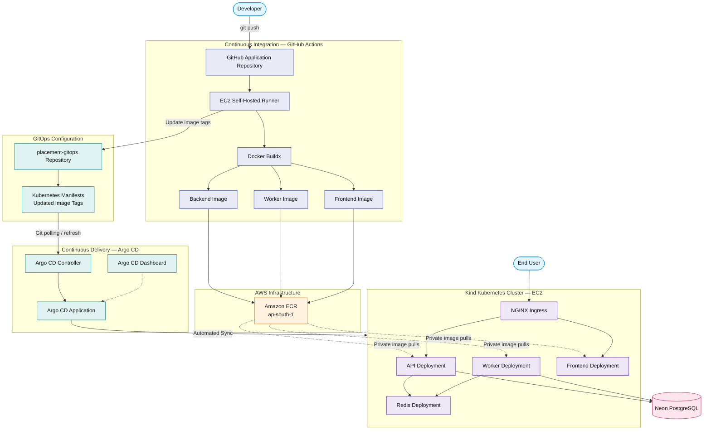
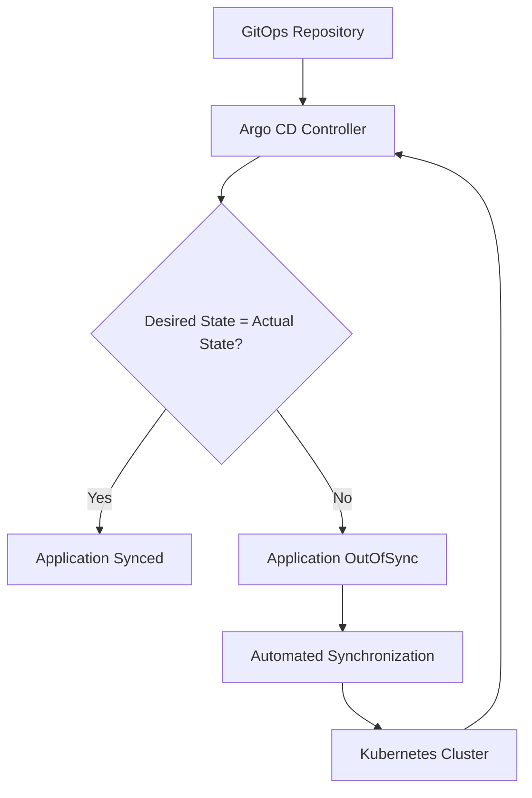

## 🏗️ Architecture Overview



### 🔄 Pipeline Execution Flow

The deployment process is divided into three major stages:

| Stage | Responsibility | Technology |
|---|---|---|
| CI | Build, tag and publish Docker images | GitHub Actions + Buildx |
| GitOps | Maintain desired Kubernetes state | GitHub GitOps Repository |
| CD | Reconcile and deploy workloads | Argo CD + Kubernetes |

---

## ⚙️ Technology Stack

| Category | Technologies |
|---|---|
| CI/CD | GitHub Actions |
| Containerization | Docker, Docker Buildx |
| Container Registry | Amazon ECR |
| Cloud Infrastructure | AWS EC2, IAM |
| Container Orchestration | Kubernetes, Kind |
| GitOps | Argo CD |
| Web Server / Routing | NGINX Ingress |
| Database | Neon PostgreSQL |
| Background Jobs | Redis |
| Secrets | GitHub Actions Secrets, Kubernetes Secrets |
| Automation | Bash, AWS CLI, kubectl |

---

## 🔨 Phase 1: Continuous Integration (CI)

GitHub Actions automates the complete application build and image publishing process.

**Workflow:** `.github/workflows/ci.yml`

### Execution Steps

1. Developer pushes code to the application repository.
2. GitHub Actions triggers the CI workflow.
3. EC2 self-hosted runner picks up the workflow.
4. AWS credentials are configured using GitHub Secrets.
5. Docker Buildx builds three application images.
6. Images are tagged using the Git commit SHA and `latest`.
7. Images are pushed to Amazon ECR.
8. CI updates the corresponding image tags in the GitOps repository.

### Docker Images

| Service | ECR Repository |
|---|---|
| Backend | `placement-backend` |
| Worker | `placement-worker` |
| Frontend | `placement-frontend` |

**Image tagging strategy:**

```text
placement-backend:c097784
placement-backend:latest

placement-worker:c097784
placement-worker:latest

placement-frontend:c097784
placement-frontend:latest
```

Using Git SHA tags provides traceability between application source code and deployed container images.

---

## 📦 Phase 2: GitOps Repository

**Repository:** `Sab-429/placement-gitops`

Instead of directly deploying Kubernetes manifests through GitHub Actions, the CI pipeline updates the image references in a separate GitOps repository.

### Repository Structure

```text
placement-gitops/
│
├── apps/
│   └── placement/
│       ├── namespace.yaml
│       ├── configmap.yaml
│       ├── ingress.yaml
│       ├── redis.yaml
│       ├── api.yaml
│       ├── worker.yaml
│       ├── frontend.yaml
│       └── kustomization.yaml
│
└── README.md
```

### How It Works

1. CI builds and pushes new images to ECR.
2. CI clones the GitOps repository.
3. The image tags inside `kustomization.yaml` are updated.
4. Updated manifests are committed and pushed to GitHub.
5. GitOps repository becomes the source of truth for the desired Kubernetes deployment configuration.

**Example image update:**

```yaml
images:
  - name: placement-backend
    newName: <AWS_ACCOUNT_ID>.dkr.ecr.ap-south-1.amazonaws.com/placement-backend
    newTag: c097784

  - name: placement-worker
    newName: <AWS_ACCOUNT_ID>.dkr.ecr.ap-south-1.amazonaws.com/placement-worker
    newTag: c097784

  - name: placement-frontend
    newName: <AWS_ACCOUNT_ID>.dkr.ecr.ap-south-1.amazonaws.com/placement-frontend
    newTag: c097784
```

---

## 🚀 Phase 3: Continuous Delivery with Argo CD

Argo CD is deployed inside the existing Kind Kubernetes cluster.

It continuously monitors the GitOps repository and compares the desired state declared in Git with the actual state of the Kubernetes cluster.

### Argo CD Workflow

1. Argo CD monitors the GitOps repository.
2. Detects new commits and manifest changes.
3. Compares desired and actual Kubernetes states.
4. Automatically synchronizes changes when configured.
5. Applies the updated Kubernetes manifests.
6. Kubernetes pulls the new images from Amazon ECR.
7. Deployments perform rolling updates.
8. Argo CD reports synchronization and application health status.

### GitOps Reconciliation



### Argo CD Features Used

| Feature | Purpose |
|---|---|
| Automated Sync | Automatically applies Git changes |
| Self-Healing | Corrects configuration drift |
| Pruning | Removes resources deleted from Git |
| Health Monitoring | Monitors application resource health |
| Git-based Rollback | Revert Git configuration to a previous version |

---

## ☸️ Phase 4: Kubernetes Deployment

**Cluster:** Kind Kubernetes running on AWS EC2

### Deployed Workloads

| Deployment | Replicas | Responsibility |
|---|---:|---|
| API | 1 | Backend application |
| Worker | 1 | Background job processing |
| Frontend | 1 | React application |
| Redis | 1 | Job queue and caching |

### Kubernetes Resources

- Namespace
- ConfigMaps
- Kubernetes Secrets
- Deployments
- ClusterIP Services
- NGINX Ingress
- ECR ImagePullSecret

### Private Image Authentication

Since the Docker images are stored in private Amazon ECR repositories, Kubernetes uses `ecr-registry-secret` to authenticate and pull images.

The ECR authorization token is refreshed through the deployment infrastructure before it expires.

---

## 🔗 Application Runtime Architecture

After successful deployment, the application components communicate as follows:

| Connection | Protocol | Purpose |
|---|---|---|
| User → Ingress | HTTP/HTTPS | External application access |
| Ingress → Frontend | HTTP | Serve React application |
| Ingress → API | HTTP | Route API requests |
| Frontend → Backend | HTTP | API communication |
| Backend → Neon | PostgreSQL/TLS | Persistent data storage |
| Backend → Redis | Redis protocol | Enqueue background jobs |
| Worker → Redis | Redis protocol | Consume background jobs |
| Worker → Resend | HTTPS | Email delivery |

### Application Request Flow

```text
             USER
               |
               v
        NGINX INGRESS
               |
       +-------+-------+
       |               |
       v               v
   FRONTEND         BACKEND API
   React SPA           |
                       |
              +--------+--------+
              |                 |
              v                 v
          PostgreSQL          Redis
            Neon                |
                                v
                          Python Worker
                                |
                                v
                           Resend API
```

---

## 🔐 Security & Secrets Management

Sensitive configuration is managed outside the GitOps repository.

| Secret | Source | Usage |
|---|---|---|
| `AWS_ACCESS_KEY_ID` | GitHub Secrets | AWS authentication |
| `AWS_SECRET_ACCESS_KEY` | GitHub Secrets | AWS authentication |
| `DB_PASSWORD` | GitHub Secrets | Neon PostgreSQL |
| `JWT_SECRET` | GitHub Secrets | JWT authentication |
| `RESEND_API_KEY` | GitHub Secrets | Email service |
| `GITOPS_PAT` | GitHub Secrets | GitOps repository access |

### Security Practices

- Sensitive values are never committed to Git.
- GitHub Secrets are used for CI authentication and runtime secret provisioning.
- Kubernetes Secrets store application credentials.
- ECR ImagePullSecret enables private registry access.
- Argo CD repository credentials are managed securely.
- Git SHA image tags provide deployment traceability.

---

## 📊 GitOps vs Traditional CI/CD

| Feature | Traditional CI/CD | GitOps with Argo CD |
|---|---|---|
| Image building | GitHub Actions | GitHub Actions |
| Image publishing | Amazon ECR | Amazon ECR |
| Manifest management | GitHub repository | Separate GitOps repository |
| Deployment execution | GitHub Actions / kubectl | Argo CD |
| Deployment model | Push-based | Pull-based reconciliation |
| Desired state | YAML files in Git | Git-backed source of truth |
| Drift detection | Manual | Automated |
| Self-healing | Not configured | Supported |
| Deployment visibility | kubectl | Argo CD Dashboard |
| Rollback | Manual deployment | Git revert + synchronization |

---

## 📋 Deployment Verification

### CI Verification

- [ ] GitHub Actions workflow completes successfully.
- [ ] All three Docker images are pushed to ECR.
- [ ] Images contain the expected Git SHA tags.
- [ ] GitOps repository receives updated image references.

### Argo CD Verification

- [ ] Argo CD is accessible.
- [ ] GitOps repository connection is successful.
- [ ] Placement Application is Synced.
- [ ] Application status is Healthy.
- [ ] Automated synchronization works.

### Kubernetes Verification

```bash
# Check Kind cluster
kind get clusters

# Check application pods
kubectl get pods -n placement

# Check deployments
kubectl get deployments -n placement

# Check services
kubectl get services -n placement

# Check ingress
kubectl get ingress -n placement

# Check Argo CD application
kubectl get applications -n argocd

# Check application health
kubectl get pods -n placement -w
```

### Application Verification

- [ ] Frontend loads successfully.
- [ ] Backend health endpoint returns HTTP 200.
- [ ] Backend connects to Neon PostgreSQL.
- [ ] Redis queue is operational.
- [ ] Worker consumes background jobs.
- [ ] Email functionality works.
- [ ] New image deployment completes successfully.

---

## 🎯 Key Engineering Concepts Demonstrated

- Automated CI/CD pipelines using GitHub Actions.
- Docker multi-service image build and publishing.
- AWS ECR private container registry integration.
- Kubernetes orchestration using Kind.
- GitOps architecture and declarative infrastructure.
- Continuous reconciliation using Argo CD.
- Kubernetes configuration drift detection and self-healing.
- Automated rolling deployments.
- External managed database integration.
- Background processing using Redis.
- Secure credential and secret management.


---
